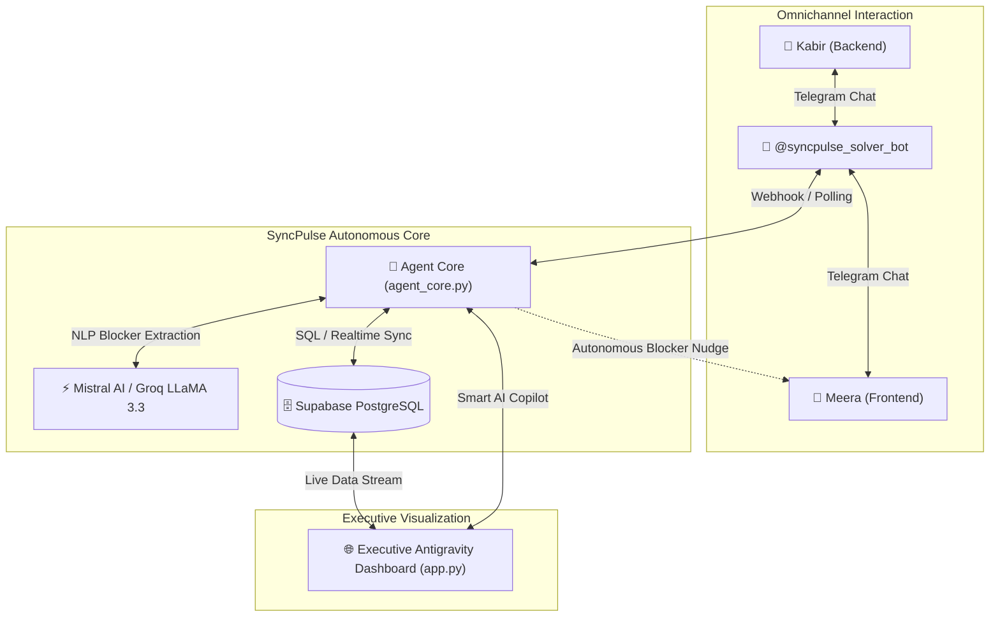

# ⚡ SyncPulse AI · Autonomous Group Project Coordinator
> **Targeting 1st Prize · Hackathon Kurukshetra (Dr. D.Y. Patil Institute of Technology, Pune)**  
> **Track W-PS-1:** AI Group Project Coordinator · Sponsored by **[Worcflow.ai](https://worcflow.ai)**


---

## 💡 The Core Problem & Vision

During hackathons and team sprints, **communication friction is the #1 reason projects fail**:
- Team members forget to update project boards.
- Dependencies between teammates (e.g. backend waiting on frontend credentials) remain silent for hours.
- Project managers waste 40% of their day micromanaging standup check-ins.

**SyncPulse AI solves this autonomously:**
1. Periodically sends proactive, natural language check-ins to team members on **Telegram**.
2. Analyzes unstructured replies using an agentic LLM pipeline (Mistral AI / Groq LLaMA 3.3).
3. Detects blockers, extracts the blocking reason, and identifies the responsible teammate.
4. **Autonomously escalates dependencies** by nudging the blocking teammate on Telegram.
5. Reflects all telemetry in real-time on an ultra-modern, glassmorphic executive dashboard.

---

## 🏛️ System Architecture



---

## 🏆 Track W-PS-1 Compliance Matrix

| Requirement from Worcflow.ai | How SyncPulse AI Fulfills It |
|---|---|
| **Autonomous Check-ins** | Scheduled Telegram bot inquiries sent directly to assigned task owners. |
| **Natural Language Understanding** | Multi-tier reasoning (Mistral-Small, Groq LLaMA-70B, Heuristic fallback) capable of understanding technical context, progress %, and Hinglish phrases. |
| **Blocker & Dependency Extraction** | Accurately extracts `is_blocked: true`, `blocker_reason`, and `blocked_by_member`. |
| **Autonomous Escalation** | Dispatches targeted Telegram nudges directly to the blocking teammate to resolve dependencies without manager intervention. |
| **Realtime Visibility** | Translucent glassmorphic dashboard with live Blocker Radar, Project Velocity KPI, and interactive AI Copilot. |

---

## ⚡ Quick Start (1-Click Run)

### 1. Clone & Install Dependencies
```bash
git clone https://github.com/your-username/SyncPulse-AI.git
cd SyncPulse-AI
pip install -r requirements.txt
```

### 2. Configure Environment (`.env`)
Create or edit `.env` in the root folder:
```env
TELEGRAM_BOT_TOKEN=8936095048:AAHGBEacdNgFe-xCLPc42JPH6oymu9z9cmo
AI_PROVIDER=mistral
MISTRAL_API_KEY=your_mistral_api_key
NEXT_PUBLIC_SUPABASE_URL=https://pzxkrzvculpgxsibafnx.supabase.co
NEXT_PUBLIC_SUPABASE_PUBLISHABLE_KEY=sb_publishable_-9Lo6rhtP5BH-aOInOi4XQ_fUJ2N7-i
```

### 3. Run the Entire System
```powershell
python run_demo.py
```
This single command:
- Starts the Web Dashboard at **`http://127.0.0.1:5000`**.
- Starts the Telegram Bot listener for **`@syncpulse_solver_bot`**.
- Automatically opens your default web browser.

---

## 🧪 Testing the Scenario (The Winning Demo Loop)

1. **Open Dashboard**: Go to `http://127.0.0.1:5000`. Notice `TASK-102: Connect Payment API` owned by Kabir.
2. **Send Telegram Message**: In Telegram, message `@syncpulse_solver_bot`:
   > *"The API is connected, but I am waiting for test credentials from Meera."*
   *(Alternatively, click the **⚡ Demo Blocker** button on the dashboard top bar).*
3. **Observe Autonomous Escalation**:
   - Dashboard card turns glowing **Red (🚨 BLOCKED)**.
   - Blocker Radar identifies **Meera** as the dependency.
   - The bot automatically messages Meera: *"Hey Meera! Kabir is waiting on test credentials to finish 'Connect Payment API'. Could you please share an update?"*
4. **Resolve Blocker**: Reply on Telegram or click **✨ Demo Resolve**:
   - Task immediately moves to **✓ Shipped**.
   - Project Velocity rises to 100%.

---

## 📁 Repository Structure

```text
ProjectCoordinator/
│
├── run_demo.py                 # 🚀 1-Click Master Launcher (Dashboard + Telegram Bot)
├── app.py                      # 🌐 Antigravity Fullscreen Glassmorphic Dashboard
├── agent_brain.py              # 🧠 Local task manager & reasoning processor
├── PITCH_DECK_AND_DEMO_SCRIPT.md # 🏆 5-minute presentation slides & judge demo script
├── tasks.json                  # 💾 Fast local milestone state store
├── supabase_schema.sql         # 🗄️ PostgreSQL schema with Realtime publication
│
├── backend/
│   ├── agent_core.py           # ⚡ Multi-LLM Agent Intelligence (Mistral / Groq)
│   ├── bot_service.py          # 🤖 Telegram Bot listener with proactive follow-up
│   ├── supabase_client.py      # 📡 PostgREST client for database CRUD
│   └── test_agent.py           # 🧪 NLP unit test suite for blocker extraction
│
└── frontend/                   # ☁️ Next.js 14 serverless cloud deployment (Vercel)
    └── app/api/telegram-webhook # 24/7 serverless webhook endpoint
```

---

## 👥 Hackathon Team & Acknowledgements
- **Event:** Hackathon Kurukshetra (Dr. D.Y. Patil Institute of Technology, Pune)
- **Track Sponsor:** [Worcflow.ai](https://worcflow.ai)
- **Built with:** Python, Flask, Supabase, Mistral AI, Groq Cloud, pyTelegramBotAPI, Bootstrap 5.
